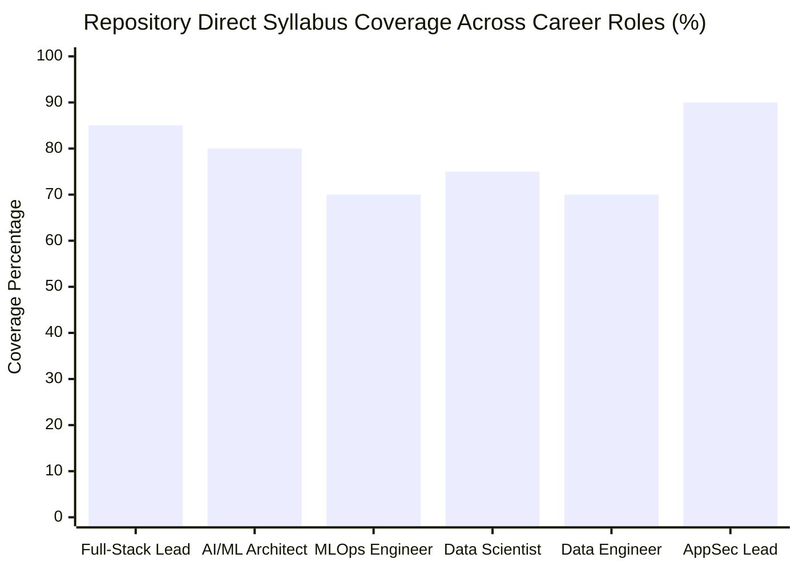

<!--
Master Career Role Alignment Matrix & Senior Positioning Strategy
=================================================================
Description: Comprehensive cross-reference matrix mapping Levels 1 through 8 against 
             six premier industry career paths. Formulates senior positioning strategy 
             for Principal Architects transitioning from Node.js/TypeScript and PHP.
Target Roles: Full-Stack Lead, Applied AI/ML Architect, MLOps Engineer, 
              Data Scientist, Data Engineer, and AppSec Engineer.

Official Documentation References:
- Python Career & Ecosystem Survey: https://www.python.org/dev/peps/
- Python Packaging Authority (PyPA): https://www.pypa.io/
- PEP 8 Style Guide: https://peps.python.org/pep-0008/
- PEP 484 Type Hints: https://peps.python.org/pep-0484/
-->

# Master Career Role Matrix & Senior Transition Strategy

## Executive Overview

This master document serves as the architectural career alignment guide for senior software professionals. Specifically engineered for a **Principal Software Architect with 13+ years of enterprise experience across Node.js/TypeScript and PHP**, this matrix maps how the 32 production modules across **Levels 1 through 8** establish concrete hands-on mastery for the highest-leverage roles in modern engineering.

Modern Python has evolved into the central backbone of enterprise infrastructure, artificial intelligence, distributed data processing, and cybersecurity. A background in Node.js/TypeScript and PHP provides an unfair advantage: deep familiarity with asynchronous event loops, high-traffic web protocols, relational ORMs, and distributed worker queues maps directly onto Python's enterprise ecosystem.

---

## 1. Master Cross-Reference Matrix

The table below outlines repository coverage, direct evidence modules, the delta required for 100% role competence, and market positioning across the six core tracks.

| Track # | Target Career Role | Core Enterprise Focus | Repo Coverage | Direct Hands-On Evidence Modules | Supplemental Topics (Remaining Delta) | Target Senior Positioning |
|---|---|---|:---:|---|---|---|
| **01** | [**Python Full-Stack Lead**](file:///P:/prabhu/projects/git_python/py_docs/docs/career_roles/01_python_full_stack_lead.md) | FastAPI, Async SQLAlchemy 2.0, WebSockets, Clean Architecture, Celery, Docker | **85%** | • [L2: FastAPI Forms & API](file:///P:/prabhu/projects/git_python/py_docs/level_2_moderate/03_fastapi_forms_post_get.py)<br>• [L3: Async SQLAlchemy 2.0](file:///P:/prabhu/projects/git_python/py_docs/level_3_high/01_async_crud_sqlalchemy.py)<br>• [L3: WebSockets](file:///P:/prabhu/projects/git_python/py_docs/level_3_high/02_websockets_realtime.py)<br>• [L4: Asyncio Event Loop](file:///P:/prabhu/projects/git_python/py_docs/level_4_expert/01_advanced_asyncio_event_loop.py)<br>• [L4: Celery & Redis](file:///P:/prabhu/projects/git_python/py_docs/level_4_expert/02_celery_redis_worker.py)<br>• [L4: Clean Architecture API](file:///P:/prabhu/projects/git_python/py_docs/level_4_expert/03_clean_architecture_enterprise_api.py)<br>• [L6: JWT & RBAC](file:///P:/prabhu/projects/git_python/py_docs/level_6_cybersecurity_appsec/02_jwt_auth_and_rbac_middleware.py)<br>• [L8: Streamlit Reactive UI](file:///P:/prabhu/projects/git_python/py_docs/level_8_gui_visual_apps/03_streamlit_reactive_ai_playground.py) | Alembic zero-downtime migrations, Strawberry GraphQL, OpenTelemetry distributed tracing, gRPC microservices | Staff / Principal Full-Stack Engineer, VP of Engineering |
| **02** | [**Applied AI/ML & GenAI Architect**](file:///P:/prabhu/projects/git_python/py_docs/docs/career_roles/02_ai_ml_engineer_architect.md) | Vector RAG, ChromaDB, ReAct Agents, GraphRAG, vLLM, LoRA Fine-Tuning | **80%** | • [L5: Scikit-Learn Pipeline](file:///P:/prabhu/projects/git_python/py_docs/level_5_ai_ml_rag_agents/01_numpy_scikit_ml_pipeline.py)<br>• [L5: ChromaDB RAG](file:///P:/prabhu/projects/git_python/py_docs/level_5_ai_ml_rag_agents/02_vector_embeddings_chromadb_rag.py)<br>• [L5: LangChain & SSE](file:///P:/prabhu/projects/git_python/py_docs/level_5_ai_ml_rag_agents/03_llm_orchestration_langchain.py)<br>• [L5: ReAct Autonomous Agent](file:///P:/prabhu/projects/git_python/py_docs/level_5_ai_ml_rag_agents/04_autonomous_agent_tool_calling.py)<br>• [L7: Ragas Triad Evaluation](file:///P:/prabhu/projects/git_python/py_docs/level_7_advanced_ai_systems/01_rag_triad_evaluation_ragas.py)<br>• [L7: Hybrid Search & RRF](file:///P:/prabhu/projects/git_python/py_docs/level_7_advanced_ai_systems/02_hybrid_search_bm25_dense.py)<br>• [L7: Knowledge Graph RAG](file:///P:/prabhu/projects/git_python/py_docs/level_7_advanced_ai_systems/03_knowledge_graph_rag.py)<br>• [L7: vLLM PagedAttention](file:///P:/prabhu/projects/git_python/py_docs/level_7_advanced_ai_systems/04_vllm_inference_serving.py)<br>• [L7: PEFT LoRA Fine-Tuning](file:///P:/prabhu/projects/git_python/py_docs/level_7_advanced_ai_systems/05_peft_lora_finetuning.py)<br>• [L7: Semantic Caching](file:///P:/prabhu/projects/git_python/py_docs/level_7_advanced_ai_systems/06_semantic_caching_and_router.py) | Model Context Protocol (MCP), Direct Preference Optimization (DPO), AWQ/GGUF quantization, LangGraph multi-agent | Lead AI Solutions Architect, Head of Generative AI |
| **03** | [**MLOps & AI Platform Engineer**](file:///P:/prabhu/projects/git_python/py_docs/docs/career_roles/03_mlops_engineer.md) | Inference Serving, Model Registries, Data Versioning, Drift Monitoring, GPU Orchestration | **70%** | • [L5: Model Pipeline & Joblib](file:///P:/prabhu/projects/git_python/py_docs/level_5_ai_ml_rag_agents/01_numpy_scikit_ml_pipeline.py)<br>• [L7: vLLM Inference Engine](file:///P:/prabhu/projects/git_python/py_docs/level_7_advanced_ai_systems/04_vllm_inference_serving.py)<br>• [L7: PEFT LoRA Adapters](file:///P:/prabhu/projects/git_python/py_docs/level_7_advanced_ai_systems/05_peft_lora_finetuning.py)<br>• [L7: Cost & Latency Router](file:///P:/prabhu/projects/git_python/py_docs/level_7_advanced_ai_systems/06_semantic_caching_and_router.py)<br>• [L8: CustomTkinter Ops Console](file:///P:/prabhu/projects/git_python/py_docs/level_8_gui_visual_apps/02_customtkinter_modern_dashboard.py)<br>• [L8: PyQt6 Multithreaded Grid](file:///P:/prabhu/projects/git_python/py_docs/level_8_gui_visual_apps/04_pyqt6_multithreaded_gui.py) | MLflow model lineage, DVC pipeline tracking, KServe Kubernetes manifests, Evidently AI drift detection | Principal MLOps Engineer, AI Platform Architect |
| **04** | [**Senior Data Scientist**](file:///P:/prabhu/projects/git_python/py_docs/docs/career_roles/04_data_scientist.md) | Vector Math, Tabular Wrangling, Statistical Inference, Scikit-Learn, Streamlit EDA | **75%** | • [L1: List/Dict Comprehensions](file:///P:/prabhu/projects/git_python/py_docs/level_1_basic/04_comprehensions_and_manipulation.py)<br>• [L2: SQLite Relational CRUD](file:///P:/prabhu/projects/git_python/py_docs/level_2_moderate/01_sqlite_crud.py)<br>• [L5: NumPy & Scikit-Learn](file:///P:/prabhu/projects/git_python/py_docs/level_5_ai_ml_rag_agents/01_numpy_scikit_ml_pipeline.py)<br>• [L7: Ragas Triad Evaluation](file:///P:/prabhu/projects/git_python/py_docs/level_7_advanced_ai_systems/01_rag_triad_evaluation_ragas.py)<br>• [L8: Streamlit Vector Inspector](file:///P:/prabhu/projects/git_python/py_docs/level_8_gui_visual_apps/03_streamlit_reactive_ai_playground.py) | Polars/Pandas DataFrame wrangling, SciPy hypothesis testing (ANOVA/Chi2), SHAP/LIME explainability | Lead Data Scientist, Decision Science Manager |
| **05** | [**Enterprise Data Engineer**](file:///P:/prabhu/projects/git_python/py_docs/docs/career_roles/05_data_engineer.md) | PySpark, DuckDB/Parquet, Airflow DAGs, Kafka Streaming, ACID Lakehouses | **70%** | • [L2: SQLite Indexing & Queries](file:///P:/prabhu/projects/git_python/py_docs/level_2_moderate/01_sqlite_crud.py)<br>• [L3: Async Connection Pooling](file:///P:/prabhu/projects/git_python/py_docs/level_3_high/01_async_crud_sqlalchemy.py)<br>• [L3: Multiprocessing Queues](file:///P:/prabhu/projects/git_python/py_docs/level_3_high/03_multithreading_vs_multiprocessing.py)<br>• [L4: Celery Distributed Tasks](file:///P:/prabhu/projects/git_python/py_docs/level_4_expert/02_celery_redis_worker.py)<br>• [L8: Desktop CRUD DB Controller](file:///P:/prabhu/projects/git_python/py_docs/level_8_gui_visual_apps/05_gui_db_crud_controller.py) | DuckDB in-process OLAP, PySpark Catalyst optimization, Apache Airflow TaskFlow API, Apache Kafka streaming | Principal Data Engineer, Data Platform Lead |
| **06** | [**AppSec & DevSecOps Engineer**](file:///P:/prabhu/projects/git_python/py_docs/docs/career_roles/06_cybersecurity_appsec.md) | OWASP PBKDF2 Hashing, Fernet AES-128, JWT RBAC, OWASP Top 10 for LLMs, Bandit SAST | **90%** | • [L6: PBKDF2 & Fernet AES](file:///P:/prabhu/projects/git_python/py_docs/level_6_cybersecurity_appsec/01_cryptography_and_hashing.py)<br>• [L6: JWT Auth & RBAC Guards](file:///P:/prabhu/projects/git_python/py_docs/level_6_cybersecurity_appsec/02_jwt_auth_and_rbac_middleware.py)<br>• [L6: SQLi & HTML Sanitization](file:///P:/prabhu/projects/git_python/py_docs/level_6_cybersecurity_appsec/03_sql_injection_and_input_sanitization.py)<br>• [L6: LLM Prompt Injection Defense](file:///P:/prabhu/projects/git_python/py_docs/level_6_cybersecurity_appsec/04_llm_prompt_injection_defense.py)<br>• [Whitepaper: OWASP LLM Checklist](file:///P:/prabhu/projects/git_python/py_docs/docs/owasp_llm_security_checklist.md) | Bandit SAST CI/CD rules, Semgrep policy enforcement, Software Bill of Materials (SBOM), HashiCorp Vault | Lead Application Security Architect, DevSecOps Director |

---

## 2. Skill Tier Coverage Breakdown (Levels 1 through 8)

```
  +---------------------------------------------------------------------------------+
  |                  ENTERPRISE PYTHON 8-TIER KNOWLEDGE FOUNDATION                  |
  +---------------------------------------------------------------------------------+
  | Level 1: Core Fundamentals       | Loops, Slicing, Dict Hashes, Comprehensions  |
  | Level 2: Backend & Transport     | SQLite Engine, Requests/HTTPX, FastAPI ASGI  |
  | Level 3: High Concurrency        | Async SQLAlchemy, WebSockets, Process Pools  |
  | Level 4: Expert Systems          | Asyncio Loops, Celery Workers, Clean Arch    |
  | Level 5: Applied AI & RAG        | Scikit Pipelines, ChromaDB, ReAct Agents     |
  | Level 6: Cybersecurity & AppSec  | PBKDF2/Fernet, JWT RBAC, OWASP LLM Defense   |
  | Level 7: Advanced AI Systems     | Ragas Triad, BM25/Dense RRF, vLLM, LoRA PEFT |
  | Level 8: GUI & Visual Dashboards | Tkinter, CustomTkinter, Streamlit, PyQt6     |
  +---------------------------------------------------------------------------------+
```

### Cumulative Competence Distribution by Role



---

## 3. Senior Career Positioning Strategy for 13+ Year Veterans

Engineers with a decade or more of enterprise experience in Node.js/TypeScript and PHP often make the mistake of positioning themselves as "Junior Python Developers" when transitioning. This is an egregious tactical error.

In reality, **software architecture principles are language-agnostic**. The core design challenges—distributed consistency, transaction isolation, latency budgeting, memory management, and security boundaries—are identical across runtimes.

### Key Conceptual Bridges: Node.js / PHP to Python

1. **Async Runtime & Event Loop Mechanics**:
   - *Node.js*: Uses the single-threaded C `libuv` event loop with Microtask (Promises) and Macrotask (`setTimeout`, `setImmediate`) queues.
   - *Python*: Standardizes on PEP 3156 `asyncio`. Tasks yield control via `await` to the event loop. Python 3.14 free-threading (PEP 703) provides true multi-core thread scaling without GIL bottlenecks.
   - *Architecture Equivalence*: [`01_advanced_asyncio_event_loop.py`](file:///P:/prabhu/projects/git_python/py_docs/level_4_expert/01_advanced_asyncio_event_loop.py) maps directly to low-level Node.js libuv event loop engineering.

2. **Object-Relational Mapping (ORM) & Connection Pooling**:
   - *TypeScript*: TypeORM, Prisma, Drizzle.
   - *PHP*: Doctrine ORM (Symfony), Eloquent (Laravel).
   - *Python*: SQLAlchemy 2.0 Async (`AsyncSession`, `select()`). SQLAlchemy is considered the gold standard of relational data mappers across the entire software industry.
   - *Architecture Equivalence*: [`01_async_crud_sqlalchemy.py`](file:///P:/prabhu/projects/git_python/py_docs/level_3_high/01_async_crud_sqlalchemy.py).

3. **Background Job Queues & Asynchronous Workers**:
   - *Node.js*: BullMQ, Bee-Queue, Agenda with Redis.
   - *PHP*: Laravel Queues / Horizon with Redis and Supervisor.
   - *Python*: Celery with Redis broker and flower monitoring.
   - *Architecture Equivalence*: [`02_celery_redis_worker.py`](file:///P:/prabhu/projects/git_python/py_docs/level_4_expert/02_celery_redis_worker.py).

4. **Security, Cryptography & Token Authentication**:
   - *TypeScript / PHP*: `jsonwebtoken`, Passport.js, `password_hash()` (Argon2id/Bcrypt).
   - *Python*: `hashlib.pbkdf2_hmac` (600,000 iterations), `cryptography.fernet`, `PyJWT` with FastAPI dependency injection security guards.
   - *Architecture Equivalence*: [`01_cryptography_and_hashing.py`](file:///P:/prabhu/projects/git_python/py_docs/level_6_cybersecurity_appsec/01_cryptography_and_hashing.py) and [`02_jwt_auth_and_rbac_middleware.py`](file:///P:/prabhu/projects/git_python/py_docs/level_6_cybersecurity_appsec/02_jwt_auth_and_rbac_middleware.py).

---

## 4. How to Navigate the Role-Specific Guides

Each role in this directory contains an exhaustive syllabus, code mappings to Levels 1–8, and explicit supplemental topics:

- [**01. Python Full-Stack Lead**](file:///P:/prabhu/projects/git_python/py_docs/docs/career_roles/01_python_full_stack_lead.md): Master FastAPI, async databases, real-time protocols, containerization, and clean architectural domain segregation.
- [**02. Applied AI/ML & GenAI Architect**](file:///P:/prabhu/projects/git_python/py_docs/docs/career_roles/02_ai_ml_engineer_architect.md): Master classical ML pipelines, vector databases, autonomous tool calling, GraphRAG, vLLM serving, and PEFT LoRA fine-tuning.
- [**03. MLOps Engineer**](file:///P:/prabhu/projects/git_python/py_docs/docs/career_roles/03_mlops_engineer.md): Bridge software delivery and machine learning with model registries, data versioning, drift observability, and Kubernetes AI serving.
- [**04. Senior Data Scientist**](file:///P:/prabhu/projects/git_python/py_docs/docs/career_roles/04_data_scientist.md): Master high-performance vectorized operations, Polars/Pandas dataframes, hypothesis testing, and Streamlit exploratory interfaces.
- [**05. Enterprise Data Engineer**](file:///P:/prabhu/projects/git_python/py_docs/docs/career_roles/05_data_engineer.md): Build scalable data backbones with DuckDB, PySpark distributed compute, Apache Airflow workflow DAGs, and Kafka stream ingestion.
- [**06. Cybersecurity & AppSec Engineer**](file:///P:/prabhu/projects/git_python/py_docs/docs/career_roles/06_cybersecurity_appsec.md): Secure enterprise architectures against OWASP Top 10 vulnerabilities, protect AI systems against prompt injection, and enforce zero-trust identity pipelines.
